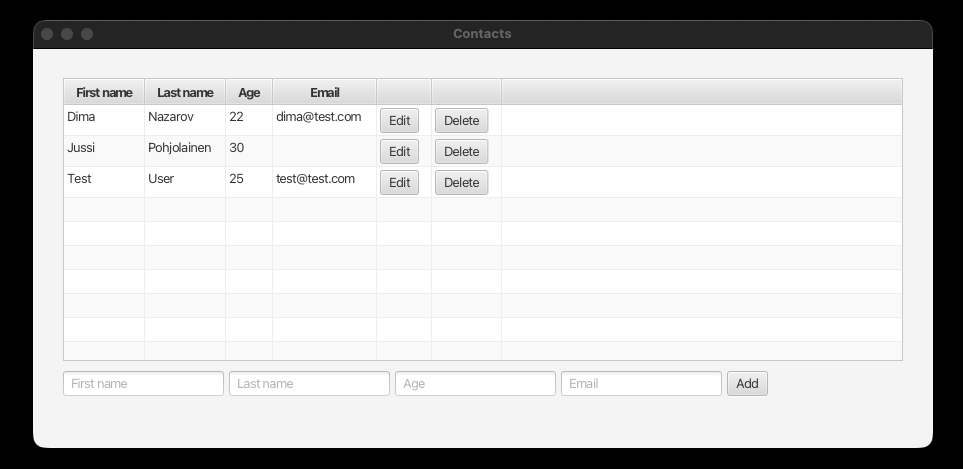
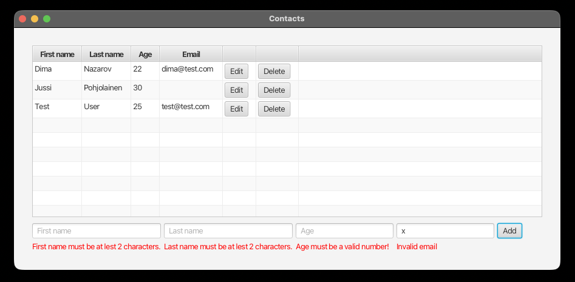
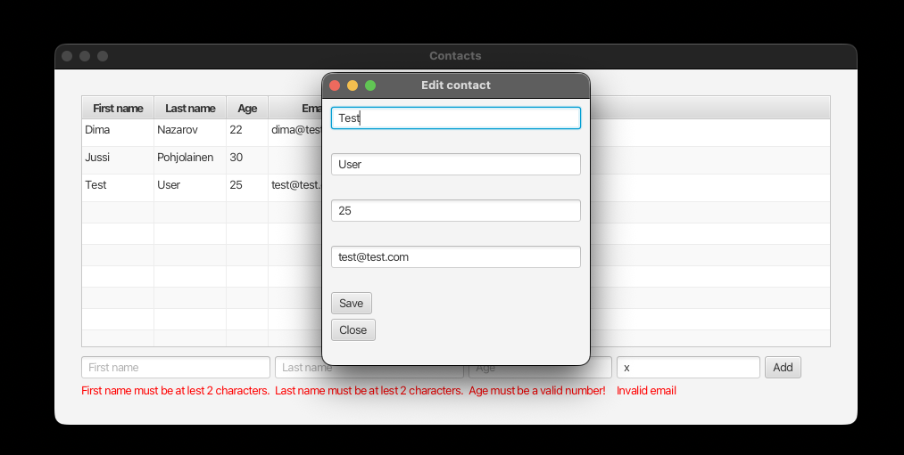
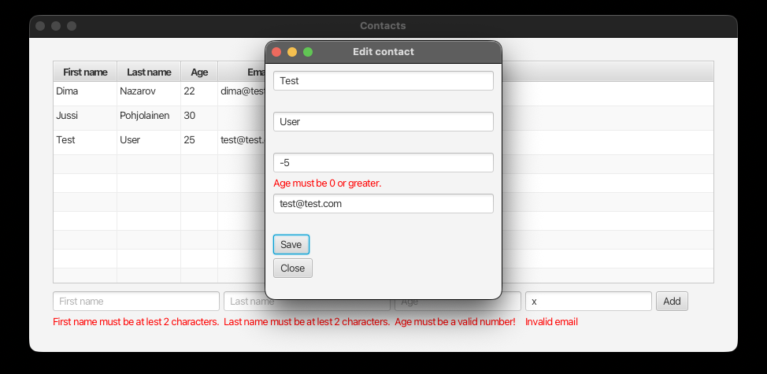
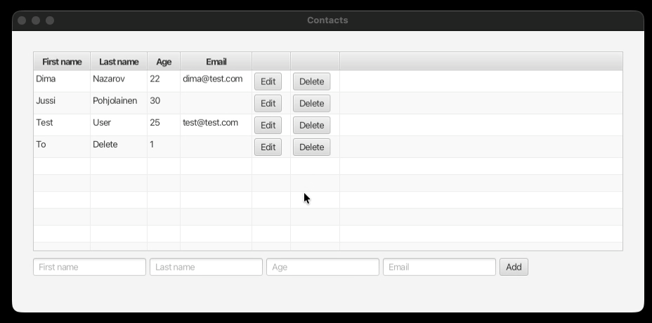
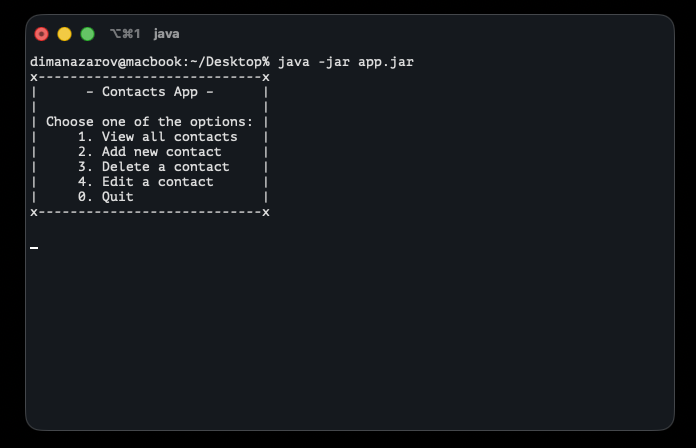
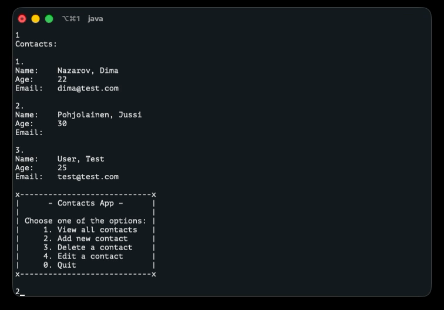
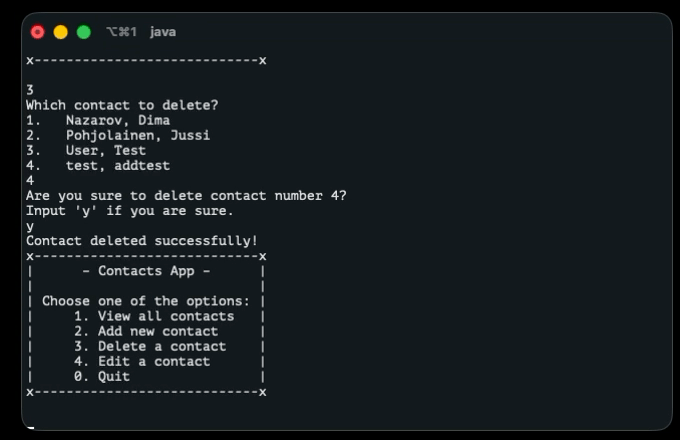
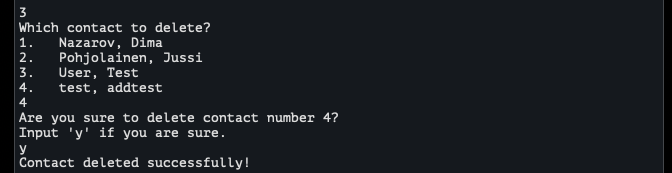

# Contacts App – Object-Oriented Programming Project

## Overview

**Contacts App** is a person management application with custom data structures. The app allows users to create, read, update, and delete persons (with first name, last name, and age) through a command-line interface or GUI (JavaFX).

This project showcases my skills in **object-oriented programming**. Including layered architecture, interface-based design, and custom data structure implementation.

Project is completed as part of the second-year Object-Oriented Programming course at Tampere University of Applied Sciences.

## Build status

Every push of commits to GitHub is done considering that the app is working, but
not all individual commits contain a working project.
Stable releases with realised functionalities are better found in releases.

## Project description

### Architecture

The application follows a clean, layered architecture:

```
CLI/JavaFX GUI
     v
Controller
     v
Repository Layer (CSVRepo or MemoryRepo, which are interchangeable)
     v
Custom Data Structures (MyArrayList or MyLinkedList, which are interchangeable)
```

### Key components

- **Custom Data Structures** implement `MyList` interface with at least one of:
  - `MyArrayList<T>`
  - `MyLinkedList<T>`

- **Repository Implementations**:
  - `CSVRepo` - updates data to `persons.csv` file
  - `MemoryRepo` – In-memory storage for testing/development

- **Controller Layer** - Separates UI from data, handles all CRUD operations

- **UI Layers**:
  - Command-line interface with a text-based menu system
  - JavaFX graphical interface

### Available operations

- **Create**: Add a new person with first name, last name, age and email
- **Read**: List all persons, with all the details to every person
- **Update**: Modify existing person information
- **Delete**: Remove a person with confirmation prompt

## Screenshots

### GUI (JavaFX)

(Main overview)


(Main overview errors)


(Edit view)


(Edit view error example)


(Delete confirmation)

### CLI-UI

(Main menu)


(Read contacts)


(Add contact)


(Add contact)


(Delete confirmation)

## Tech

- **Language**: Java 25
- **Build Tool**: Gradle
- **UI**: OPTIONAL Command-Line Interface or JavaFX GUI
- **JUnit** tests
- **Sun Checkstyle**

## How to compile and run

### Run of the release-version

1. Running GUI version:
- after installing the projects zip-file:
```bash
   cd contactsapp/src/app/bin
   ./app
```

2. Running CLI version
- After installing the projects zip-file:
```bash
cd contactsapp
java -jar cli.jar
```

### Build

```bash
./gradlew build
```

### Run

```bash
./gradlew run
```

### Using MemoryRepo (development)

By default, the app uses `CSVRepo`. To use `MemoryRepo` for testing, modify the initialization in the main class.

## Features

- Basic CRUD operations (Create, Read, Update, Delete)
- Clean architecture with separated layers (UI, controller, repository, data type)
- Custom `myList` data structure implementation with `myLinkedList` and `myArrayList`
- Multiple repository implementations (CSV, Memory)
- Error handling and validation
- Confirmation prompts for destructive operations
- Data persistence via CSV file

## AI usage and learning resources

AI was used heavily in JavaFX, Checkstyle, JUnit configuration to work with my Gradle version and Java 25.
Also learning recources were scarce on the topic of JavaFX so learning of the principles and
syntax were done with AI help.

Also a lot of tutorials were watched on the topic of JavaFX.

**Tools**:

- Claude (chat) for concepts and explanations

## Development notes

### To swap repository implementation

Edit the initialization in `App.java` to switch between CSV and memory storage:

Either have this for CSVRepo:

```java
Repository repository = new CSVRepo(persons, "datastorage/persons.csv");
```

Or this for MemoryRepo:

```java
Repository repository = new MemoryRepo(persons);
```

### To swap data structure implementation

Edit the initialization in `App.java` to switch between different MyList implementations:

```java
MyList<Person> persons = new MyArrayList<Person>();
```

```java
MyList<Person> persons = new MyLinkedList<Person>();
```

### To swap UI implementations:

Edit initialization in `App.java` to switch between CLI-UI (TerminalUI) or JavaFX GUI (FXUI).

```java
    FXUI.setController(controller);
    Application.launch(FXUI.class, args);
```

```java
    TerminalUI ui = new TerminalUI(controllerUI);
    ui.start();
```
